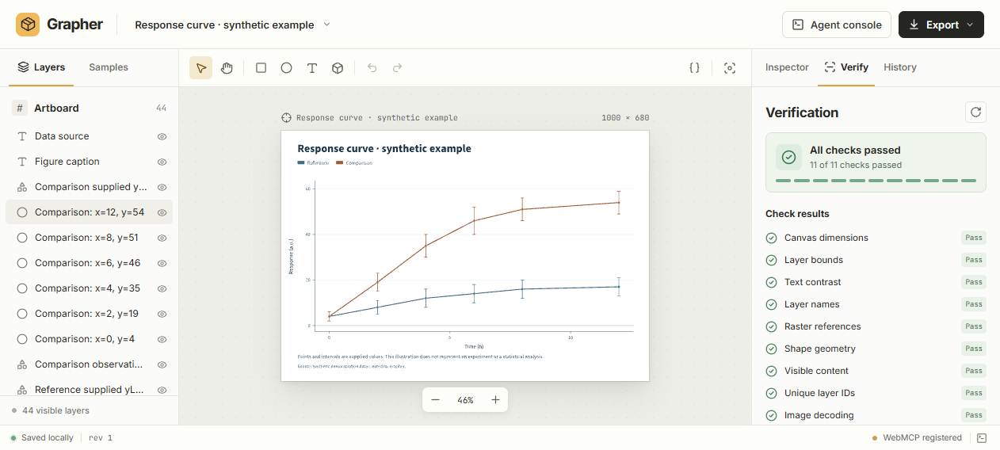
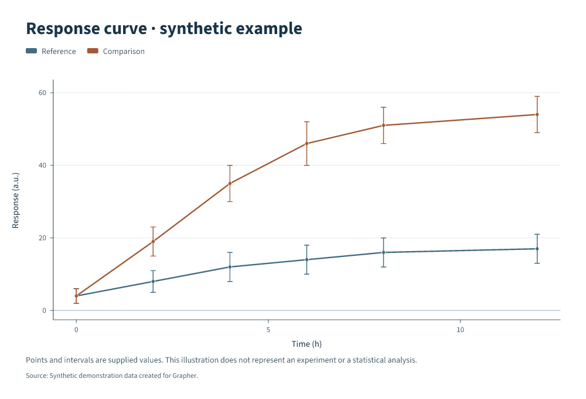

# Grapher

Grapher is a local graphics workspace for agents. Agents create editable scenes, check their structure and rendered output, and revise the same saved document. The first quality focus is diagrams and scientific figures; use cases are sample content, not application modes.



## Run

Requires **Node.js 24 or later**.

```sh
npm ci
npm run build
npm start
```

Open [the studio](http://localhost:5173). `npm start` serves the built application and its API without Vite. It binds to loopback; `PORT` changes the port. For development, use `npm run dev` instead.

The document menu creates blank documents, duplicates existing work, imports scene JSON, and opens samples. Samples create separate documents. **History** restores any saved revision as a new revision. Undo and redo are available for the current editing session. The selected document persists in the URL and local browser storage.

Documents and their complete revision history persist in `.grapher/workspace.sqlite`. `GRAPHER_DATA_DIR` selects a different data directory. SQLite transactions protect atomic edits and revision checks across concurrent connections. For a complete backup, stop the server and copy the data directory; JSON export preserves an individual scene without its history.

## Agent workflow

1. Discover capabilities and saved document IDs.
2. Inspect the target document and its revision.
3. Compose a diagram or plot, or apply an atomic batch of layer operations.
4. Check the returned report. Repair supported issues and review unresolved warnings.
5. Export a revision-pinned PNG and visually inspect it before delivering SVG, PDF, or PNG.

```sh
npm run --silent cli -- capabilities
npm run --silent cli -- documents
npm run --silent cli -- compose examples/diagram.json --create
npm run --silent cli -- plot examples/plot.json --create
```

Copy the returned `documentId` and current `revision` into subsequent commands:

```sh
npm run --silent cli -- inspect --document DOCUMENT_ID
npm run --silent cli -- verify --document DOCUMENT_ID
npm run --silent cli -- export png figure.png --document DOCUMENT_ID --revision 1 --scale 2
npm run --silent cli -- export pdf figure.pdf --document DOCUMENT_ID --revision 1
npm run --silent cli -- export svg figure.svg --document DOCUMENT_ID --revision 1 --outline-text
npm run --silent cli -- history --document DOCUMENT_ID
npm run --silent cli -- restore 1 --document DOCUMENT_ID --revision 2
```

Revision numbers above are examples. A stale revision returns HTTP 409. Inspect again before deciding how to apply an edit. `verify` exits with code 2 if any checks fail or need review. Omitted document IDs target the workspace's default document, independent of the document selected in a browser. Pass `--url` or set `GRAPHER_URL` to select a server.

`apply edits.json` accepts an array of typed operations (`add`, `replace`, `remove`, `move`, `update`, `reorder`, `gradients`, `canvas`). `replace scene.json` replaces a document's content; `create scene.json` imports it into a new document. `-` reads JSON from stdin. `verify scene.json` and `render scene.json output.svg` work offline with the bundled fonts. `--help` lists all commands.

### Composition

`compose` accepts nodes, edges, labels, descriptions, shapes, colors, direction and theme. ELK arranges the graph and routes separate orthogonal edges. Labels wrap using actual font metrics; arrow terminals meet curved or diamond boundaries. The result is ordinary editable vector layers with stable IDs.

`plot` accepts explicit numeric series for line, scatter and bar plots. It provides linear axes, ticks, units, legends, captions, source text and supplied `yLow`/`yHigh` intervals. Bars include a zero baseline. Explicit domains cannot exclude observations or intervals. It does not calculate statistics or infer uncertainty. The response-curve sample is clearly labeled synthetic.

Generated scenes retain their original composition inputs in `provenance`, including exact numeric observations. Agents can compare artwork with that source. This is a snapshot at generation time: later layer edits preserve it but do not rewrite it or prove that the artwork still matches it.



Layer primitives include rectangles, ellipses, text, paths, embedded PNG/JPEG and basic meshes. Vector features include strokes, dashes, arrows, linear/radial gradients, opacity and rotation. Text supports measured wrapping, line height, letter spacing and bundled fonts. Discover exact schemas and limits through `capabilities`.

### MCP and WebMCP

Keep the workspace server running and launch the stdio MCP server with the repository as its working directory:

```sh
npm run --silent mcp
```

Tools are `grapher_capabilities`, `grapher_documents`, `grapher_create`, `grapher_inspect`, `grapher_compose`, `grapher_plot`, `grapher_apply`, `grapher_replace`, `grapher_verify`, `grapher_repair`, `grapher_history`, `grapher_restore`, and `grapher_export`. PNG exports return image content for a vision-capable agent; PDF and GLB return binary resources.

The studio registers the same domain tools through native WebMCP when supported by the browser. Browser tools default to the selected document and accept an explicit `documentId`. Vercel UI SDK additionally exposes `snapshot`, `query`, and `act` for interface interactions. [Chrome WebMCP setup](https://developer.chrome.com/docs/ai/webmcp/)

### Agent console

Built-in verification, repair, samples and protocol tools work locally without credentials. For open-ended briefs, set `AI_GATEWAY_API_KEY` in the environment or an ignored `.env.local`, then restart. `GRAPHER_MODEL` chooses a Vercel AI Gateway model supporting tools and image input; the default is `openai/gpt-5-mini`.

The console can inspect, compose diagrams or plots, edit layers, verify, repair, and inspect a rendered PNG within one run. Each run stays attached to its originating document. Its instructions require supplied scientific data and flag missing inputs; semantic correctness still requires review.

## Exports and verification

| Output | Behavior |
| --- | --- |
| SVG | Embedded bundled fonts and editable text by default; `--outline-text` converts text to paths for portable appearance. |
| PNG | Same outlined glyphs as the preview/PDF; scale 0.1–4, maximum 64 million pixels. |
| PDF | One vector page, outlined text, preserved embedded images; one scene pixel maps to 0.75 PDF points. Conversion warnings fail the export. |
| JSON | Complete editable scene, including raster data. |
| GLB | Visible cube, sphere and torus mesh layers. Unsupported compositing opacity or 2D rotation fails export explicitly. The 3D view remains a limited primitive workflow. |

Verification includes dimensions, actual parsed path bounds, measured text bounds, sampled flat-color contrast, naming, embedded image structure, geometry, visibility, unique IDs, full image decoding, font coverage and successful rasterization. There are 11 check groups. Unsupported contrast sampling and complex text shaping produce warnings rather than passes. Invalid render inputs are rejected before edits are committed; out-of-bounds and contrast findings can remain editable for repair.

Fonts are Source Sans 3 (including Greek), Barlow, Crimson Text, and Courier Prime. Regular and bold files and their licenses are bundled in `public/fonts`. The canvas, PNG and PDF use the same glyph outlines to prevent machine-dependent font substitution. Scene JSON retains editable text. Arbitrary font families normalize to this set.

Passing checks demonstrates the properties that were tested. It does not establish scientific truth, desirable composition, absence of all overlaps, accessibility across every background, or compliance with a publisher's requirements. Inspect the actual artifact. Complex-script shaping, arbitrary SVG/PDF import, multipage layout, CMYK/prepress, advanced photo editing, and full 3D authoring remain outside the current implementation. This is an improving local tool, not yet a complete replacement for every graphics subscription or a hosted multiuser service.

## Implementation and validation

TypeScript/Zod define documents, operations and protocol contracts. React/Vite serve the studio. SQLite stores documents and revisions; ELK composes graphs; OpenType font data measures and outlines text; Resvg renders PNG; PDFKit and SVG-to-PDFKit produce PDF; Sharp decodes raster assets; Three.js and glTF Transform handle primitive 3D.

The interface uses **[vercel-labs/ui](https://github.com/vercel-labs/ui)** via `@ui-sdk/core` and `@ui-sdk/react`, pinned to `0.1.0-beta.3`. It supplies menus, tabs, buttons, focus/keyboard behavior and agent component semantics. Vercel **AI SDK UI** separately handles streamed console messages.

```sh
npm test
npm run build
```

Tests exercise concurrent writes and restart persistence, restore semantics, scoped HTTP operations and exports, malformed assets, glyph and arrow rendering, measured diagram routing, and scientific plot semantics. GitHub Actions runs tests and builds on Windows and Linux with Node 24.

The [graphics editor research](docs/research/graphics-modes.md) compares the requested products and documents why Grapher uses shared typed content with contextual views.
